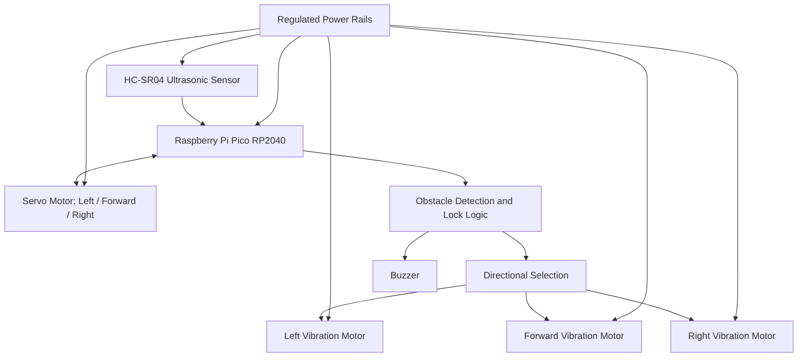

# Navihaptics — Directional Obstacle Detection with Haptic Feedback

> A low-cost smart-cane prototype that scans the space in front of a user and communicates close obstacles through direction-specific vibration feedback.

**Project type:** Embedded systems / assistive technology  
**Controller:** Raspberry Pi Pico (RP2040)  
**Firmware:** Arduino IDE / C++  
**Repository:** Individual project

## Overview

Navihaptics is an assistive navigation prototype designed to help a visually impaired user identify nearby obstacles. A single HC-SR04 ultrasonic sensor is mounted on a servo motor and scans three directions: left, forward, and right. The Raspberry Pi Pico reads the distance measurement and determines whether an obstacle has entered the configured close-range zone.

During normal scanning, the vibration motors and buzzer remain OFF. When an obstacle is detected at or below the lock threshold, the servo holds the corresponding scan position, the buzzer activates continuously, and only the vibration motor associated with that direction is activated. The system releases the lock when the measured distance exceeds the release threshold or a valid echo is no longer received.

The prototype uses haptic feedback so that directional alerts do not depend only on audible signals.

## Key features

- Three-direction scanning using one servo-mounted ultrasonic sensor
- Left, forward, and right directional haptic outputs
- Distance-based obstacle lock with separate lock and release thresholds
- Continuous buzzer and one direction-specific vibration motor during a lock
- Outputs remain inactive during normal scanning
- Low-cost embedded implementation using the Raspberry Pi Pico

## System block diagram



## Operating sequence

1. The servo moves to the left, forward, and right scan positions.
2. The ultrasonic sensor measures the distance at each settled position.
3. If the distance is greater than the lock threshold, scanning continues with all alerts OFF.
4. If an obstacle is detected within the lock threshold, the servo holds that direction.
5. The buzzer and only the corresponding directional vibration motor turn ON.
6. The system remains locked until the release condition is met.
7. Once released, all alert outputs turn OFF and scanning resumes.

## Hardware

| Component | Quantity |
|---|---:|
| Raspberry Pi Pico (RP2040) | 1 |
| HC-SR04 ultrasonic sensor | 1 |
| SG90 micro servo motor | 1 |
| Vibration motors | 3 |
| BC547 NPN transistors | 3 |
| 1 kΩ base resistors | 3 |
| 1N4148 diodes (prototype parts) | 3 |
| Active buzzer | 1 |
| Smart-cane body / mounting structure | 1 |
| Jumper wires and prototyping board | As required |
| Suitable regulated power source | As required |

See [hardware/wiring-and-components.md](hardware/wiring-and-components.md) for wiring and electrical precautions.

## Firmware

The complete Arduino sketch is in [src/navihaptics.ino](src/navihaptics.ino).

- Board package: **Raspberry Pi Pico/RP2040**
- Board selection: **Raspberry Pi Pico**
- Servo library: **Servo** (use a Pico-compatible implementation if the standard library is not supported by the installed core)
- Serial Monitor: **115200 baud**

The pin mapping is documented in [hardware/pinout.csv](hardware/pinout.csv).

## Algorithm and engineering documentation

- [System architecture](docs/system-architecture.md)
- [Obstacle detection algorithm](docs/algorithm.md)
- [Design decisions and calibration](docs/design-decisions.md)
- [Testing and validation checklist](docs/testing.md)
- [Known limitations and future scope](docs/future-scope.md)
- [Contributions and AI disclosure](docs/contribution-and-ai-disclosure.md)

## Prototype status

The project was submitted through the institution to the **AICTE Indovation Centre, Chennai**, in response to its technology-transfer prototype call. The project was also presented as a product idea during an AICTE Innovations online meeting. The project owner reports the prototype at **TRL 4**; formal independent certification or field-trial results are not claimed in this repository.

Testing observations should be added to the testing document as they are recorded. A working prototype demonstration does not by itself establish clinical effectiveness or replace a conventional mobility cane.

## Repository structure

```text
navihaptics-smart-cane/
├── README.md
├── LICENSE
├── .gitignore
├── src/
│   └── navihaptics.ino
├── hardware/
│   ├── pinout.csv
│   └── wiring-and-components.md
├── docs/
│   ├── algorithm.md
│   ├── system-architecture.md
│   ├── design-decisions.md
│   ├── testing.md
│   ├── future-scope.md
│   └── contribution-and-ai-disclosure.md
└── media/
    └── README.md
```

## Safety and intended use

Navihaptics is an educational prototype. It must not be treated as a certified mobility aid or used as the sole means of navigation. Ultrasonic sensors can miss, misread, or fail to detect some surfaces and obstacles. Test in a controlled environment with a companion before any supervised demonstration.

Electrical note: the Raspberry Pi Pico GPIO pins are **3.3 V only**. The HC-SR04 ECHO output is typically 5 V; use a suitable voltage divider or logic-level shifter before connecting ECHO to GP3. Power the servo and vibration motors from supplies capable of handling their current, and connect supply grounds to Pico GND.

## Author

**S. Divya Darshan**  
Individual student hardware project

---
If you build on this project, document hardware revisions, firmware changes, and test conditions so that prototype results remain reproducible.
