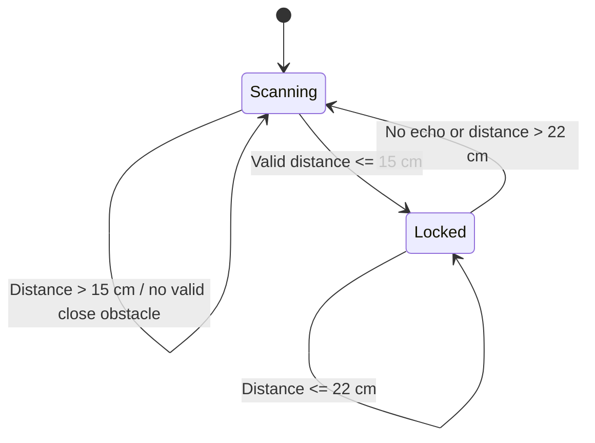

# System Architecture

## Functional overview

Navihaptics is organized into sensing, actuation, decision, and feedback stages.

1. **Sensing:** One HC-SR04 ultrasonic sensor measures the distance in the direction selected by the servo.
2. **Positioning:** The SG90 servo points the sensor toward left, forward, or right.
3. **Processing:** The Raspberry Pi Pico reads the echo pulse duration, converts it to an approximate distance, and applies lock/release thresholds.
4. **Directional feedback:** Three independently switched vibration motors represent left, forward, and right. An active buzzer provides an audible warning during a lock.
5. **State control:** The firmware has a scanning state and a locked state. While locked, the scan index does not advance.

## Hardware architecture

| Subsystem | Implementation |
|---|---|
| Controller | Raspberry Pi Pico / RP2040 |
| Range sensing | HC-SR04 ultrasonic module |
| Sensor positioning | SG90 servo |
| Haptic output | Three vibration motors |
| Motor switching | Three BC547 low-side drivers |
| Audible output | Active buzzer |
| Firmware interface | Arduino IDE and Serial Monitor |

## State model

## Direction mapping

| Scan index | Servo command | Direction | Haptic output |
|---:|---:|---|---|
| 0 | 10° | Left | Left motor |
| 1 | 50° | Forward | Forward motor |
| 2 | 90° | Right | Right motor |

These are calibrated servo command values for the assembled prototype. Mechanical mounting and servo horn alignment determine the physical direction.

## Signal flow

The controller first commands the servo to a scan position, waits for the mechanism to settle, and then triggers the ultrasonic measurement. This ordering prevents a distance measurement from being incorrectly associated with the previous servo position.

During a lock, the servo command remains at the acquired angle. The firmware repeatedly checks distance at that direction and keeps the buzzer and selected vibration motor active until the release condition is met.
